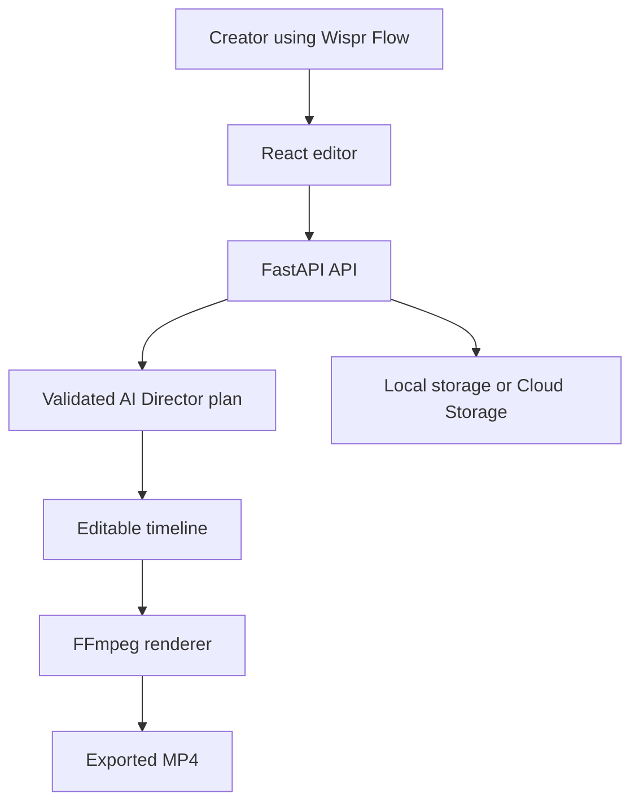

<div align="center">

# RayFlow AI

### A video editor built by voice with Wispr Flow

**Speak an idea. Shape an edit. Keep control of every frame.**

RayFlow AI is a voice-first video editing studio created for the Wispr Flow
hackathon. I built the experience by talking through the product with Wispr
Flow: describing the editor I wanted, prompting voice agents to turn creative
direction into implementation steps, and iterating on the interface by voice.


**Live demo:** https://rayflow-frontend-wd6lscqf3a-el.a.run.app

</div>

## The hackathon story

RayFlow is the result of a conversational development loop. Instead of
starting with a rigid specification, I used Wispr Flow to speak naturally
about the creative problem, ask voice agents to propose implementation paths,
and refine each interaction while seeing the product take shape.

The prompts were deliberately human and iterative:

- “Help me turn this rough video idea into an editable vertical reel.”
- “Make the director feel like a collaborator who proposes edits I can approve.”
- “Keep the timeline understandable while making the first draft feel cinematic.”
- “Check the mobile editor after resizing and fix anything that gets in the way.”

Wispr Flow made the distance between an idea and a working feature much
shorter. RayFlow is the artifact of that process: a practical editor where
voice, agents, and direct manipulation work together.

## What RayFlow does

RayFlow edits real uploaded media. It does not generate replacement footage or
hide decisions behind a one-click export. The workflow is:

1. Describe the creative direction with Wispr Flow or type it normally.
2. Let the AI Director turn that direction into a proposed editing plan.
3. Review the plan, adjust the timeline, and approve only what belongs in the cut.
4. Export a real MP4 through the FFmpeg rendering pipeline.

The result is an editable timeline, not a black-box answer.

## Features

| Feature | What it enables |
| --- | --- |
| **Wispr Flow voice workflow** | Speak product ideas, creative direction, and implementation prompts naturally while building and using the app. |
| **AI Director** | Ask for changes such as “make this more cinematic” and review the proposed operations before applying them. |
| **Editable timeline** | Trim, reorder, split, add transitions, titles, color presets, and music without losing control. |
| **Auto Reel** | Start from cinematic, minimalist, or high-energy templates and refine the generated draft. |
| **Beat-aware pacing** | Analyze audio locally with Librosa and use detected beats to guide cuts. |
| **Captions** | Create manual captions or use the optional local Faster-Whisper workflow. |
| **MP4 export** | Render locally with FFmpeg or through the documented Cloud Run job in production. |

## How the voice-agent loop works


The important boundary is approval. Agents can help translate intent into
concrete actions, but they do not silently rewrite the project. Every plan is
bounded by the operations the editor supports and remains visible to the user.

## Architecture

The frontend is a React 19/Vite application. The backend is FastAPI with local
or Cloud Run rendering. SQLite and the local filesystem support development;
Google Cloud Storage can provide shared production persistence. Provider
connections, AI Director requests, captions, and rendering stay behind the
backend boundary.



## Run locally

### Frontend

```bash
cd frontend
npm install
npm run dev
```

### Backend

```bash
cd backend
python -m venv venv
# Windows: venv\Scripts\activate
# macOS/Linux: source venv/bin/activate
pip install -r requirements.txt
uvicorn app.main:app --reload --port 8000
```

For the complete local and production setup, see
[deployment.md](docs/deployment.md) and
[GCP_CLOUD_RUN_DEPLOYMENT.md](GCP_CLOUD_RUN_DEPLOYMENT.md).

## Documentation

| Document | Purpose |
| --- | --- |
| [Voice Director](docs/voice-director.md) | Voice-first editing and provider workflow |
| [Director integration](docs/director-integration.md) | AI Director architecture and approval flow |
| [Deployment](docs/deployment.md) | Local development and production deployment |
| [Cloud Run deployment](GCP_CLOUD_RUN_DEPLOYMENT.md) | Production deployment checklist |
| [Security](SECURITY.md) | Secrets, privacy, validation, and isolation |
| [Design](design.md) | Product and interaction principles |

## Built with Wispr Flow

Wispr Flow is not a logo added after the fact. It is the way this project was
imagined, implemented, tested, and refined. Voice made it natural to move from
“I want an editor that feels like a creative conversation” to concrete UI,
backend, and workflow decisions. RayFlow is my demonstration of what happens
when speaking to an agent becomes part of the development environment itself.

**RayFlow AI** — *a video editor shaped by voice, agents, and human approval.*
